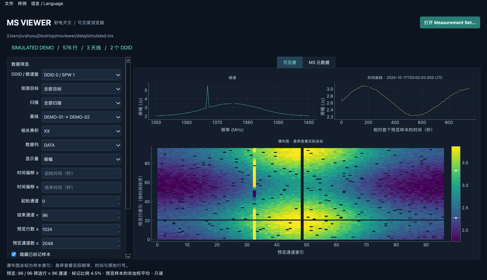

# MS Viewer

一个使用 **Python + PyQt6 + python-casacore + PyQtGraph** 的射电天文 Measurement Set v2 只读查看器。



## Mac 应用安装（无需配置 Python）

在 [GitHub Releases](https://github.com/urahyou/MS-Viewer/releases) 下载 Apple Silicon 的 DMG，
打开后将 **MS Viewer.app 拖到 Applications**。安装包包含运行环境、三份离线样例及中文 PDF 教程。
当前验证平台是 macOS 27.2 / Apple Silicon；Intel Mac 尚未支持。
测试版采用 ad-hoc 签名，尚未经过 Apple 公证，首次打开可能有系统提示。
详细步骤见 [Mac 安装与构建说明](docs/macos-install.md)。

源码管理仓库：[urahyou/MS-Viewer](https://github.com/urahyou/MS-Viewer)。项目采用 GPL-3.0-only；
第三方许可证说明见 [THIRD_PARTY_NOTICES.md](THIRD_PARTY_NOTICES.md)。

## 从源码启动

当前项目已在 `.venv` 安装好依赖，并下载、解压了两个公开 MS 样例：

```bash
cd /Users/urahyou/Desktop/msviewer
.venv/bin/python -m msviewer --demo
```

打开官方 ALMA / BIMA 测试样例，或你自己的 MS 目录：

```bash
.venv/bin/python -m msviewer data/mssel_test_small.ms
.venv/bin/python -m msviewer data/mssel_test_small_multifield_spw.ms
.venv/bin/python -m msviewer /path/to/observation.ms
```

也可以不带参数启动，在 `Samples` 菜单选择样例，或点击 `Open Measurement Set…` 选择 `.ms` 目录。

MS 通常是一个目录，必须保留子表与原始目录结构。这个应用不修改数据或 Flag。

## 全新安装

推荐 Python 3.12。macOS Apple Silicon 上优先用 Conda 安装 casacore，PyQt6 等依赖由 pip 安装；不依赖完整 CASA：

```bash
conda env create --prefix ./.venv --file environment.yml
conda run --prefix ./.venv python -m msviewer --demo
```

Linux 上如果有可用的 python-casacore wheel，也可以使用普通 venv：

```bash
python3.12 -m venv .venv
.venv/bin/python -m pip install -e '.[dev]'
.venv/bin/python -m msviewer.datasets --all
.venv/bin/python -m msviewer --demo
```

已在 macOS arm64 / Python 3.12 / PyQt6 6.12 / python-casacore 3.8.1 上实际运行。其他系统尚未验证。

图解教程：[MS 查看器与 MeasurementSet 入门 PDF](output/pdf/MS查看器与MeasurementSet_天文学家视角入门.pdf)。

## 中英文切换

窗口顶部的 **语言 / Language** 菜单提供 **中文** 和 **English**，选择后立即生效，不需要重启。
语言偏好会自动保存，下次启动继续使用。按钮、菜单、筛选标签、显示量、图轴、元数据标题、
状态/错误提示及文件对话框跟随语言更新。MS 中的目标名、天线名、列名、相关乘积与单位保留原值，
底层库的原始诊断信息也会保留。

切换语言不会重新读取数据或重置筛选、缩放范围、色条；读取过程中也可以切换。

[中文截图](artifacts/chinese-preview.png) · [English screenshot](artifacts/english-preview.png)

## 功能与操作

- 浏览 MS 主表行数、天线、Field、频谱窗、DDID→SPW/偏振关系、时间范围和数据列。
- 根据 DDID、Field、Scan、**有方向的基线**、相关乘积、数据列筛选；选择变化后自动更新，也可点击 Apply。
- 频率谱、时间曲线、时间排序的行×通道瀑布图；支持振幅、相位、实部、虚部。
- 支持 `DATA`、`CORRECTED_DATA`、`MODEL_DATA`、`FLOAT_DATA`（仅列出文件中存在的列）。
- 同时考虑 `FLAG` 与 `FLAG_ROW`；可切换是否隐藏 flagged 样本；统计显示当前相关乘积的 **preview Flag 比例**。
- 调整通道范围、时间范围、预览行数/通道数；后台读取，缩放、平移、调整色条、导出 PNG。
- 命令行检查元数据，不启动 GUI：

```bash
.venv/bin/python -m msviewer --inspect data/mssel_test_small.ms
```

时间筛选输入相对于**整个 MS 最早 TIME** 的秒数，留空表示不限制；时间上下界均包含。
通道从 0 开始，start 包含、end 不包含，例如 `[10, 20)` 读取第 10–19 通道。
基线按 ANTENNA1→ANTENNA2 保留，不自动合并反向基线，也不自动复共轭。
相关乘积标签来自 POLARIZATION 表，XX/YY 不会被假定为 Stokes I。

## 三份演示数据

| 本地目录 | 来源 / 内容 | 大小 |
|---|---|---|
| `data/simulated.ms` | 本项目生成，明确标记 SIMULATED；3 天线、2 个 DDID、96/48 通道、模拟 RFI 和 Flag | 576 行 |
| `data/mssel_test_small.ms` | casacore 官方测试集；OBSERVATION 标为 ALMA，含 13 天线和 2 个 Field | 1,058 行；压缩包 608,580 字节 |
| `data/mssel_test_small_multifield_spw.ms` | casacore 官方测试集；OBSERVATION 标为 BIMA，含 10 天线、9 个 Field、6 个 DDID | 14,985 行；压缩包 4,818,441 字节 |

公开样例是上游的**回归测试数据**，上游没有完整说明历史预处理过程，因此不将其宣称为未经处理的原始观测。
来源固定到 casacore 提交 `a1399b6b99907bd14021920a089403a93c10aba1`：

- [ALMA 测试 MS](https://github.com/casacore/casacore/blob/a1399b6b99907bd14021920a089403a93c10aba1/ms/MSSel/test/mssel_test_small.ms.tgz)
- [BIMA 多目标/频谱窗测试 MS](https://github.com/casacore/casacore/blob/a1399b6b99907bd14021920a089403a93c10aba1/ms/MSSel/test/mssel_test_small_multifield_spw.ms.tgz)

下载器只下载到本地，校验大小和 SHA256，并拒绝归档中的越界路径、符号链接及非普通文件。
压缩包和解压数据在 `.gitignore` 中，不自动提交到 Git。来源和 SHA256 见 `src/msviewer/sample_catalog.json`，下载时也保存为 `data/sources.json`。

```bash
.venv/bin/python -m msviewer.datasets --all
# 或指定目录
.venv/bin/python -m msviewer.datasets --all --destination /path/to/samples
```

单通道选择会显示一个带标记的频谱点及实际频率，并提示瀑布图横向为同一通道。
读取新的数据选择后会恢复曲线的可见范围；单个有效数值也会自动调整纵轴。

首次演示 BIMA 时，可切换到 **DDID 2 / SPW 2** 查看 64 通道数据；默认 DDID 0 只有一个通道。
模拟数据使用固定随机种子；`--demo` 仅在目标路径不存在时生成，已有目录不会被覆盖。

## 数值含义与当前边界

- **预览不是全数据统计。** 默认最多 1,024 行×2,048 通道；行在当前筛选结果的时间排序中均匀抽取，通道等步长抽取，不进行平均降采样。
- 可见度预览按内存预算进一步减少行数（64 MiB 的保守估算预算，非整个进程内存上限）。元数据按块扫描；casacore 的筛选/排序仍可能随 MS 行数增长。
- 曲线是有效预览样本的**非加权平均**。振幅是 `mean(abs(V))`，相位是各有效相位的圆周平均；零可见度和合向量抵消时相位显示为空；未使用 WEIGHT/WEIGHT_SPECTRUM，也未进行校准或成像。
- 瀑布图横纵轴是预览通道/行索引，**不假定频率和时间等间距**。悬停显示实际频率、带参考系的时间、原 MS 行号和数值。色条默认采用有效值的 2–98 百分位，相位固定 ±180°。
- TIME 按列的参考系和 MJD 0 起算秒数转换；支持固定 UTC/TAI/TT/UT1/TDB/TCG/TCB，变量时间参考系会明确报错。频率直接来自 CHAN_FREQ，不做频率参考系转换。
- 不提供 Flag 写入、Stokes 合成、速度轴、UV 成像或完整 CASA plotms 兼容性。尚未用 TB 级 MS 做性能基准。
- Linux 无显示环境可运行测试；Windows 的 casacore 原生安装尚未验证。

## TDD 与验证

每层都先写测试并实际观察失败，再实现并运行通过；记录在 `docs/tdd-log.md`，失败/通过日志保存在 `artifacts/`。
最终验证为 **79 个测试通过、0 跳过**，并通过 Ruff 检查与 wheel 打包。
测试使用真实 casacore MS 文件，而非仅 Mock 读取器；Qt 集成测试实际运行后台任务与绘图组件。

```bash
QT_QPA_PLATFORM=offscreen .venv/bin/python -m pytest -q
.venv/bin/python -m ruff check src tests scripts
.venv/bin/python -m ruff format --check src tests scripts
```

公开样例未下载时，两个公开数据集成测试会跳过；先运行下载命令即可完整验证。
涵盖混合 DDID 形状、频率轴顺序、Flag 行、全 Flag、跨 ±180° 相位、时间/通道范围、采样上限、FLOAT_DATA、只读性、异步切换、错误恢复、关闭生命周期和归档提取。

## 项目结构

```text
src/msviewer/
  model.py          数据契约
  reader.py         MS 元数据、筛选与有界读取
  processing.py     Mask、振幅/相位及平均
  window.py         Qt 界面与绘图
  workers.py        后台任务
  demo.py           可复现的模拟 MS
  datasets.py       公开样例下载与校验
  __main__.py       GUI / inspect 命令行入口
```

后续可以在现有读取层上增加 UV coverage、分页主表浏览、加权平均和 Flag 编辑；Flag 编辑应独立设计撤销、持久化和备份策略。
